# 1. Esquema completo de `menaje_db`

*Generado automáticamente desde la base de datos en ejecución (solo lectura) con `docs/informe-datos/scripts/generar_esquema.py`.*

* Motor: **PostgreSQL 16.15 (Debian 16.15-1.pgdg12+2) on x86_64-pc-linux-gnu** (imagen `pgvector/pgvector:pg16`, puerto 5433 del equipo → 5432 del contenedor).
* Extensiones instaladas: `pgcrypto` 1.3, `plpgsql` 1.0, `vector` 0.8.7.
* **17 tablas** y **1 vista(s)** en el esquema `public`.

## 1.1 Resumen de tablas

| Tabla | Filas | Clave primaria | Claves foráneas |
|---|---:|---|---|
| `alquiler_eventos` | 1 | id | alquiler_id→alquileres, usuario_id→usuarios |
| `alquiler_items` | 3650 | id | alquiler_id→alquileres, producto_id→productos |
| `alquileres` | 307 | id | cliente_id→usuarios |
| `busquedas_ia` | 0 | id | — |
| `categorias` | 6 | id | — |
| `cierre_garantia` | 1 | id | alquiler_id→alquileres, cerrado_por→usuarios |
| `configuracion` | 1 | clave | — |
| `conversaciones_ia` | 4 | id | usuario_id→usuarios |
| `descuentos_cliente` | 1 | id | asignado_por→usuarios, usuario_id→usuarios |
| `pagos` | 2 | id | alquiler_id→alquileres, registrado_por→usuarios |
| `paquete_items` | 58 | id | paquete_id→paquetes, producto_id→productos |
| `paquetes` | 10 | id | — |
| `productos` | 38 | id | categoria_id→categorias |
| `pronosticos` | 1 | id | — |
| `revision_items` | 1 | id | alquiler_id→alquileres, alquiler_item_id→alquiler_items |
| `stock_movimientos` | 2 | id | producto_id→productos, usuario_id→usuarios |
| `usuarios` | 12 | id | — |
| `demanda_categoria_mes` *(vista)* | 132 | — | — |

## 1.2 Detalle por tabla

### `alquiler_eventos` (1 filas)

| Columna | Tipo | ¿Nulo? | Valor por defecto | Clave |
|---|---|---|---|---|
| `id` | `integer` | no | `nextval('alquiler_eventos_id_seq'::regclass)` | PK |
| `alquiler_id` | `integer` | no |  | FK → alquileres.id |
| `estado_antes` | `varchar(30)` | sí |  |  |
| `estado_nuevo` | `varchar(30)` | no |  |  |
| `usuario_id` | `integer` | no |  | FK → usuarios.id |
| `metodo` | `varchar(20)` | sí | `'manual'::character varying` |  |
| `created_at` | `timestamp with time zone` | sí | `now()` |  |

Restricciones `CHECK` / `UNIQUE`:

* `alquiler_eventos_metodo_check`: `CHECK (((metodo)::text = ANY (ARRAY[('qr'::character varying)::text, ('manual'::character varying)::text])))`

Índices:

* `alquiler_eventos_pkey`: `CREATE UNIQUE INDEX alquiler_eventos_pkey ON public.alquiler_eventos USING btree (id)`

### `alquiler_items` (3650 filas)

| Columna | Tipo | ¿Nulo? | Valor por defecto | Clave |
|---|---|---|---|---|
| `id` | `integer` | no | `nextval('alquiler_items_id_seq'::regclass)` | PK |
| `alquiler_id` | `integer` | no |  | FK → alquileres.id |
| `producto_id` | `integer` | no |  | FK → productos.id |
| `cantidad` | `integer` | no |  |  |
| `precio_unit` | `numeric(10,2)` | no |  |  |
| `subtotal` | `numeric(10,2)` | sí |  |  |

Restricciones `CHECK` / `UNIQUE`:

* `alquiler_items_cantidad_check`: `CHECK ((cantidad > 0))`

Índices:

* `alquiler_items_pkey`: `CREATE UNIQUE INDEX alquiler_items_pkey ON public.alquiler_items USING btree (id)`
* `idx_alquiler_items_alq`: `CREATE INDEX idx_alquiler_items_alq ON public.alquiler_items USING btree (alquiler_id)`

### `alquileres` (307 filas)

| Columna | Tipo | ¿Nulo? | Valor por defecto | Clave |
|---|---|---|---|---|
| `id` | `integer` | no | `nextval('alquileres_id_seq'::regclass)` | PK |
| `cliente_id` | `integer` | no |  | FK → usuarios.id |
| `fecha_entrega` | `date` | no |  |  |
| `hora_entrega` | `time without time zone` | sí |  |  |
| `fecha_recojo` | `date` | no |  |  |
| `hora_recojo` | `time without time zone` | sí |  |  |
| `direccion_evento` | `text` | no |  |  |
| `subtotal` | `numeric(10,2)` | no | `0` |  |
| `descuento_pct` | `numeric(5,2)` | no | `0` |  |
| `descuento_monto` | `numeric(10,2)` | no | `0` |  |
| `garantia` | `numeric(10,2)` | no | `0` |  |
| `total` | `numeric(10,2)` | no | `0` |  |
| `estado` | `varchar(30)` | no | `'confirmado'::character varying` |  |
| `qr_token` | `uuid` | sí | `gen_random_uuid()` |  |
| `created_at` | `timestamp with time zone` | sí | `now()` |  |
| `updated_at` | `timestamp with time zone` | sí | `now()` |  |
| `lat` | `numeric(10,7)` | sí |  |  |
| `lng` | `numeric(10,7)` | sí |  |  |
| `es_ejemplo` | `boolean` | no | `false` |  |
| `tipo_evento` | `varchar(30)` | sí |  |  |
| `num_asistentes` | `integer` | sí |  |  |

Restricciones `CHECK` / `UNIQUE`:

* `alquileres_estado_check`: `CHECK (((estado)::text = ANY (ARRAY[('confirmado'::character varying)::text, ('entregado'::character varying)::text, ('recogido'::character varying)::text, ('en_revision'::character varying)::text, ('cerrado'::character varying)::text])))`
* `alquileres_num_asistentes_check`: `CHECK (((num_asistentes IS NULL) OR (num_asistentes > 0)))`
* `alquileres_qr_token_key`: `UNIQUE (qr_token)`
* `alquileres_tipo_evento_check`: `CHECK (((tipo_evento IS NULL) OR ((tipo_evento)::text = ANY ((ARRAY['boda'::character varying, 'quinceanos'::character varying, 'bautizo'::character varying, 'cumpleanos'::character varying, 'graduacion'::character varying, 'corporativo'::character varying, 'baby_shower'::character varying])::text[]))))`

Índices:

* `alquileres_pkey`: `CREATE UNIQUE INDEX alquileres_pkey ON public.alquileres USING btree (id)`
* `alquileres_qr_token_key`: `CREATE UNIQUE INDEX alquileres_qr_token_key ON public.alquileres USING btree (qr_token)`
* `idx_alquileres_cliente`: `CREATE INDEX idx_alquileres_cliente ON public.alquileres USING btree (cliente_id)`
* `idx_alquileres_es_ejemplo`: `CREATE INDEX idx_alquileres_es_ejemplo ON public.alquileres USING btree (es_ejemplo) WHERE es_ejemplo`
* `idx_alquileres_estado`: `CREATE INDEX idx_alquileres_estado ON public.alquileres USING btree (estado)`
* `idx_alquileres_qr`: `CREATE INDEX idx_alquileres_qr ON public.alquileres USING btree (qr_token)`

### `busquedas_ia` (0 filas)

| Columna | Tipo | ¿Nulo? | Valor por defecto | Clave |
|---|---|---|---|---|
| `id` | `bigint` | no | `nextval('busquedas_ia_id_seq'::regclass)` | PK |
| `tipo` | `varchar(20)` | no |  |  |
| `consulta` | `text` | no |  |  |
| `n_resultados` | `integer` | no |  |  |
| `created_at` | `timestamp with time zone` | no | `now()` |  |

Restricciones `CHECK` / `UNIQUE`:

* `busquedas_ia_n_resultados_check`: `CHECK ((n_resultados >= 0))`
* `busquedas_ia_tipo_check`: `CHECK (((tipo)::text = ANY ((ARRAY['semantica'::character varying, 'similares'::character varying])::text[])))`

Índices:

* `busquedas_ia_pkey`: `CREATE UNIQUE INDEX busquedas_ia_pkey ON public.busquedas_ia USING btree (id)`
* `idx_busquedas_ia_fecha`: `CREATE INDEX idx_busquedas_ia_fecha ON public.busquedas_ia USING btree (created_at DESC)`

### `categorias` (6 filas)

| Columna | Tipo | ¿Nulo? | Valor por defecto | Clave |
|---|---|---|---|---|
| `id` | `integer` | no | `nextval('categorias_id_seq'::regclass)` | PK |
| `nombre` | `varchar(50)` | no |  |  |

Restricciones `CHECK` / `UNIQUE`:

* `categorias_nombre_key`: `UNIQUE (nombre)`

Índices:

* `categorias_nombre_key`: `CREATE UNIQUE INDEX categorias_nombre_key ON public.categorias USING btree (nombre)`
* `categorias_pkey`: `CREATE UNIQUE INDEX categorias_pkey ON public.categorias USING btree (id)`

### `cierre_garantia` (1 filas)

| Columna | Tipo | ¿Nulo? | Valor por defecto | Clave |
|---|---|---|---|---|
| `id` | `integer` | no | `nextval('cierre_garantia_id_seq'::regclass)` | PK |
| `alquiler_id` | `integer` | no |  | FK → alquileres.id |
| `garantia_cobrada` | `numeric(10,2)` | no |  |  |
| `monto_descontado` | `numeric(10,2)` | no | `0` |  |
| `monto_devuelto` | `numeric(10,2)` | no | `0` |  |
| `monto_adicional` | `numeric(10,2)` | no | `0` |  |
| `observaciones` | `text` | sí |  |  |
| `cerrado_por` | `integer` | no |  | FK → usuarios.id |
| `created_at` | `timestamp with time zone` | sí | `now()` |  |

Restricciones `CHECK` / `UNIQUE`:

* `cierre_garantia_alquiler_id_key`: `UNIQUE (alquiler_id)`

Índices:

* `cierre_garantia_alquiler_id_key`: `CREATE UNIQUE INDEX cierre_garantia_alquiler_id_key ON public.cierre_garantia USING btree (alquiler_id)`
* `cierre_garantia_pkey`: `CREATE UNIQUE INDEX cierre_garantia_pkey ON public.cierre_garantia USING btree (id)`

### `configuracion` (1 filas)

| Columna | Tipo | ¿Nulo? | Valor por defecto | Clave |
|---|---|---|---|---|
| `clave` | `varchar(80)` | no |  | PK |
| `valor` | `text` | no |  |  |

Índices:

* `configuracion_pkey`: `CREATE UNIQUE INDEX configuracion_pkey ON public.configuracion USING btree (clave)`

### `conversaciones_ia` (4 filas)

| Columna | Tipo | ¿Nulo? | Valor por defecto | Clave |
|---|---|---|---|---|
| `id` | `uuid` | no | `gen_random_uuid()` | PK |
| `usuario_id` | `integer` | no |  | FK → usuarios.id |
| `mensaje_usuario` | `text` | no |  |  |
| `respuesta_ia` | `text` | no |  |  |
| `timestamp` | `timestamp with time zone` | sí | `now()` |  |
| `tokens_usados` | `integer` | sí |  |  |
| `estado` | `varchar(20)` | no | `'completada'::character varying` |  |
| `embedding` | `vector(384)` | sí |  |  |
| `contexto_rag` | `jsonb` | sí |  |  |

Restricciones `CHECK` / `UNIQUE`:

* `conversaciones_ia_estado_check`: `CHECK (((estado)::text = ANY ((ARRAY['completada'::character varying, 'error'::character varying])::text[])))`

Índices:

* `conversaciones_ia_pkey`: `CREATE UNIQUE INDEX conversaciones_ia_pkey ON public.conversaciones_ia USING btree (id)`
* `idx_conversaciones_embedding_hnsw`: `CREATE INDEX idx_conversaciones_embedding_hnsw ON public.conversaciones_ia USING hnsw (embedding vector_cosine_ops)`
* `idx_conversaciones_estado`: `CREATE INDEX idx_conversaciones_estado ON public.conversaciones_ia USING btree (estado)`
* `idx_conversaciones_timestamp`: `CREATE INDEX idx_conversaciones_timestamp ON public.conversaciones_ia USING btree ("timestamp")`
* `idx_conversaciones_usuario`: `CREATE INDEX idx_conversaciones_usuario ON public.conversaciones_ia USING btree (usuario_id)`

### `descuentos_cliente` (1 filas)

| Columna | Tipo | ¿Nulo? | Valor por defecto | Clave |
|---|---|---|---|---|
| `id` | `integer` | no | `nextval('descuentos_cliente_id_seq'::regclass)` | PK |
| `usuario_id` | `integer` | no |  | FK → usuarios.id |
| `porcentaje` | `numeric(5,2)` | no |  |  |
| `asignado_por` | `integer` | no |  | FK → usuarios.id |
| `created_at` | `timestamp with time zone` | sí | `now()` |  |
| `updated_at` | `timestamp with time zone` | sí | `now()` |  |

Restricciones `CHECK` / `UNIQUE`:

* `descuentos_cliente_porcentaje_check`: `CHECK (((porcentaje >= (0)::numeric) AND (porcentaje <= (100)::numeric)))`
* `descuentos_cliente_usuario_id_key`: `UNIQUE (usuario_id)`

Índices:

* `descuentos_cliente_pkey`: `CREATE UNIQUE INDEX descuentos_cliente_pkey ON public.descuentos_cliente USING btree (id)`
* `descuentos_cliente_usuario_id_key`: `CREATE UNIQUE INDEX descuentos_cliente_usuario_id_key ON public.descuentos_cliente USING btree (usuario_id)`

### `pagos` (2 filas)

| Columna | Tipo | ¿Nulo? | Valor por defecto | Clave |
|---|---|---|---|---|
| `id` | `integer` | no | `nextval('pagos_id_seq'::regclass)` | PK |
| `alquiler_id` | `integer` | no |  | FK → alquileres.id |
| `monto` | `numeric(10,2)` | no |  |  |
| `metodo` | `varchar(50)` | no |  |  |
| `registrado_por` | `integer` | no |  | FK → usuarios.id |
| `created_at` | `timestamp with time zone` | sí | `now()` |  |

Índices:

* `pagos_pkey`: `CREATE UNIQUE INDEX pagos_pkey ON public.pagos USING btree (id)`

### `paquete_items` (58 filas)

| Columna | Tipo | ¿Nulo? | Valor por defecto | Clave |
|---|---|---|---|---|
| `id` | `integer` | no | `nextval('paquete_items_id_seq'::regclass)` | PK |
| `paquete_id` | `integer` | no |  | FK → paquetes.id |
| `producto_id` | `integer` | no |  | FK → productos.id |
| `cantidad` | `integer` | no |  |  |

Restricciones `CHECK` / `UNIQUE`:

* `paquete_items_cantidad_check`: `CHECK ((cantidad > 0))`

Índices:

* `idx_paquete_items_paquete`: `CREATE INDEX idx_paquete_items_paquete ON public.paquete_items USING btree (paquete_id)`
* `paquete_items_pkey`: `CREATE UNIQUE INDEX paquete_items_pkey ON public.paquete_items USING btree (id)`

### `paquetes` (10 filas)

| Columna | Tipo | ¿Nulo? | Valor por defecto | Clave |
|---|---|---|---|---|
| `id` | `integer` | no | `nextval('paquetes_id_seq'::regclass)` | PK |
| `nombre` | `varchar(150)` | no |  |  |
| `descripcion` | `text` | sí |  |  |
| `foto_url` | `text` | sí |  |  |
| `activo` | `boolean` | sí | `true` |  |
| `created_at` | `timestamp with time zone` | sí | `now()` |  |

Índices:

* `paquetes_pkey`: `CREATE UNIQUE INDEX paquetes_pkey ON public.paquetes USING btree (id)`

### `productos` (38 filas)

| Columna | Tipo | ¿Nulo? | Valor por defecto | Clave |
|---|---|---|---|---|
| `id` | `integer` | no | `nextval('productos_id_seq'::regclass)` | PK |
| `nombre` | `varchar(150)` | no |  |  |
| `categoria_id` | `integer` | no |  | FK → categorias.id |
| `descripcion` | `text` | sí |  |  |
| `precio_unidad` | `numeric(10,2)` | no |  |  |
| `stock_total` | `integer` | no | `0` |  |
| `stock_baja` | `integer` | no | `0` |  |
| `foto_url` | `text` | sí |  |  |
| `activo` | `boolean` | sí | `true` |  |
| `created_at` | `timestamp with time zone` | sí | `now()` |  |
| `embedding` | `vector(384)` | sí |  |  |
| `descripcion_busqueda` | `text` | sí |  |  |

Restricciones `CHECK` / `UNIQUE`:

* `productos_stock_baja_check`: `CHECK (((stock_baja >= 0) AND (stock_baja <= stock_total)))`
* `productos_stock_total_check`: `CHECK ((stock_total >= 0))`

Índices:

* `idx_productos_embedding_hnsw`: `CREATE INDEX idx_productos_embedding_hnsw ON public.productos USING hnsw (embedding vector_cosine_ops)`
* `productos_pkey`: `CREATE UNIQUE INDEX productos_pkey ON public.productos USING btree (id)`

### `pronosticos` (1 filas)

| Columna | Tipo | ¿Nulo? | Valor por defecto | Clave |
|---|---|---|---|---|
| `id` | `bigint` | no | `nextval('pronosticos_id_seq'::regclass)` | PK |
| `tipo_evento` | `varchar(30)` | no |  |  |
| `mes` | `smallint` | no |  |  |
| `asistentes` | `integer` | no |  |  |
| `modo` | `varchar(12)` | no |  |  |
| `version_modelo` | `varchar(80)` | no |  |  |
| `salida` | `jsonb` | no |  |  |
| `created_at` | `timestamp with time zone` | no | `now()` |  |

Restricciones `CHECK` / `UNIQUE`:

* `pronosticos_asistentes_check`: `CHECK ((asistentes > 0))`
* `pronosticos_mes_check`: `CHECK (((mes >= 1) AND (mes <= 12)))`
* `pronosticos_modo_check`: `CHECK (((modo)::text = ANY ((ARRAY['modelo'::character varying, 'degradado'::character varying])::text[])))`

Índices:

* `idx_pronosticos_fecha`: `CREATE INDEX idx_pronosticos_fecha ON public.pronosticos USING btree (created_at DESC)`
* `pronosticos_pkey`: `CREATE UNIQUE INDEX pronosticos_pkey ON public.pronosticos USING btree (id)`

### `revision_items` (1 filas)

| Columna | Tipo | ¿Nulo? | Valor por defecto | Clave |
|---|---|---|---|---|
| `id` | `integer` | no | `nextval('revision_items_id_seq'::regclass)` | PK |
| `alquiler_id` | `integer` | no |  | FK → alquileres.id |
| `alquiler_item_id` | `integer` | no |  | FK → alquiler_items.id |
| `cantidad_ok` | `integer` | no | `0` |  |
| `cantidad_rota` | `integer` | no | `0` |  |
| `cantidad_faltante` | `integer` | no | `0` |  |
| `descripcion_dano` | `text` | sí |  |  |
| `todo_conforme` | `boolean` | sí | `false` |  |

Índices:

* `idx_revision_alquiler`: `CREATE INDEX idx_revision_alquiler ON public.revision_items USING btree (alquiler_id)`
* `revision_items_pkey`: `CREATE UNIQUE INDEX revision_items_pkey ON public.revision_items USING btree (id)`

### `stock_movimientos` (2 filas)

| Columna | Tipo | ¿Nulo? | Valor por defecto | Clave |
|---|---|---|---|---|
| `id` | `integer` | no | `nextval('stock_movimientos_id_seq'::regclass)` | PK |
| `producto_id` | `integer` | no |  | FK → productos.id |
| `tipo` | `varchar(30)` | no |  |  |
| `cantidad` | `integer` | no |  |  |
| `motivo` | `text` | sí |  |  |
| `usuario_id` | `integer` | no |  | FK → usuarios.id |
| `created_at` | `timestamp with time zone` | sí | `now()` |  |

Restricciones `CHECK` / `UNIQUE`:

* `stock_movimientos_tipo_check`: `CHECK (((tipo)::text = ANY (ARRAY[('entrada'::character varying)::text, ('baja'::character varying)::text, ('correccion'::character varying)::text])))`

Índices:

* `stock_movimientos_pkey`: `CREATE UNIQUE INDEX stock_movimientos_pkey ON public.stock_movimientos USING btree (id)`

### `usuarios` (12 filas)

| Columna | Tipo | ¿Nulo? | Valor por defecto | Clave |
|---|---|---|---|---|
| `id` | `integer` | no | `nextval('usuarios_id_seq'::regclass)` | PK |
| `nombre` | `varchar(150)` | no |  |  |
| `dni` | `varchar(8)` | no |  |  |
| `telefono` | `varchar(15)` | sí |  |  |
| `correo` | `varchar(150)` | no |  |  |
| `password` | `text` | no |  |  |
| `rol` | `varchar(20)` | no |  |  |
| `activo` | `boolean` | sí | `true` |  |
| `created_at` | `timestamp with time zone` | sí | `now()` |  |

Restricciones `CHECK` / `UNIQUE`:

* `usuarios_correo_key`: `UNIQUE (correo)`
* `usuarios_dni_key`: `UNIQUE (dni)`
* `usuarios_rol_check`: `CHECK (((rol)::text = ANY (ARRAY[('cliente'::character varying)::text, ('trabajador'::character varying)::text, ('dueno'::character varying)::text])))`

Índices:

* `usuarios_correo_key`: `CREATE UNIQUE INDEX usuarios_correo_key ON public.usuarios USING btree (correo)`
* `usuarios_dni_key`: `CREATE UNIQUE INDEX usuarios_dni_key ON public.usuarios USING btree (dni)`
* `usuarios_pkey`: `CREATE UNIQUE INDEX usuarios_pkey ON public.usuarios USING btree (id)`

## 1.3 Vistas

### `demanda_categoria_mes` (132 filas)

| Columna | Tipo |
|---|---|
| `mes` | `date` |
| `categoria` | `character varying` |
| `unidades` | `integer` |
| `alquileres` | `integer` |
| `unidades_ejemplo` | `integer` |

```sql
SELECT date_trunc('month'::text, a.fecha_entrega::timestamp with time zone)::date AS mes,
    c.nombre AS categoria,
    sum(ai.cantidad)::integer AS unidades,
    count(DISTINCT a.id)::integer AS alquileres,
    COALESCE(sum(ai.cantidad) FILTER (WHERE a.es_ejemplo), 0::bigint)::integer AS unidades_ejemplo
   FROM alquileres a
     JOIN alquiler_items ai ON ai.alquiler_id = a.id
     JOIN productos p ON p.id = ai.producto_id
     JOIN categorias c ON c.id = p.categoria_id
  GROUP BY (date_trunc('month'::text, a.fecha_entrega::timestamp with time zone)::date), c.nombre;
```

## 1.4 Columnas vectoriales (pgvector)

| Tabla.columna | Tipo | Índice HNSW | Filas con vector / total | Modelo que lo genera |
|---|---|---|---|---|
| `conversaciones_ia.embedding` | `vector(384)` | sí (`vector_cosine_ops`) | 3 / 4 | `intfloat/multilingual-e5-small` (normalizado; consulta con prefijo `query: `, documento con `passage: `) |
| `productos.embedding` | `vector(384)` | sí (`vector_cosine_ops`) | 38 / 38 | `intfloat/multilingual-e5-small` (normalizado; consulta con prefijo `query: `, documento con `passage: `) |

La similitud usada en todo el sistema es `1 - (a <=> b)`, es decir, **1 − distancia de coseno** (`<=>` de pgvector).

## 1.5 Columnas documentales (JSONB)

| Tabla.columna | Contenido |
|---|---|
| `conversaciones_ia.contexto_rag` | `{"productos": [{id, nombre, similitud}], "memoria": [{id, similitud, mensaje_usuario}], "umbral_productos", "umbral_memoria"}` lo que recuperó el RAG para esa respuesta (NULL si el RAG no corrió). |
| `pronosticos.salida` | `{"Copa": 459, "Vaso": 120, ...}` demanda estimada por categoría de cada pronóstico calculado. |

## 1.6 Diagrama entidad-relación (Mermaid)

```mermaid
erDiagram
    usuarios ||--o{ alquileres : "cliente_id"
    alquileres ||--o{ alquiler_eventos : "alquiler_id"
    usuarios ||--o{ alquiler_eventos : "usuario_id"
    alquileres ||--o{ alquiler_items : "alquiler_id"
    productos ||--o{ alquiler_items : "producto_id"
    alquileres ||--o{ cierre_garantia : "alquiler_id"
    usuarios ||--o{ cierre_garantia : "cerrado_por"
    usuarios ||--o{ conversaciones_ia : "usuario_id"
    usuarios ||--o{ descuentos_cliente : "asignado_por"
    usuarios ||--o{ descuentos_cliente : "usuario_id"
    alquileres ||--o{ pagos : "alquiler_id"
    usuarios ||--o{ pagos : "registrado_por"
    paquetes ||--o{ paquete_items : "paquete_id"
    productos ||--o{ paquete_items : "producto_id"
    categorias ||--o{ productos : "categoria_id"
    alquileres ||--o{ revision_items : "alquiler_id"
    alquiler_items ||--o{ revision_items : "alquiler_item_id"
    productos ||--o{ stock_movimientos : "producto_id"
    usuarios ||--o{ stock_movimientos : "usuario_id"
    alquiler_eventos {
        integer id PK
        integer alquiler_id FK
        varchar_30 estado_antes
        varchar_30 estado_nuevo
        integer usuario_id FK
        varchar_20 metodo
        timestamp_with_time_zone created_at
    }
    alquiler_items {
        integer id PK
        integer alquiler_id FK
        integer producto_id FK
        integer cantidad
        numeric_10_2 precio_unit
        numeric_10_2 subtotal
    }
    alquileres {
        integer id PK
        integer cliente_id FK
        date fecha_entrega
        time_without_time_zone hora_entrega
        date fecha_recojo
        time_without_time_zone hora_recojo
        text direccion_evento
        numeric_10_2 subtotal
        numeric_5_2 descuento_pct
        numeric_10_2 descuento_monto
        numeric_10_2 garantia
        numeric_10_2 total
        varchar_30 estado
        uuid qr_token
        timestamp_with_time_zone created_at
        timestamp_with_time_zone updated_at
        numeric_10_7 lat
        numeric_10_7 lng
        boolean es_ejemplo
        varchar_30 tipo_evento
        integer num_asistentes
    }
    busquedas_ia {
        bigint id PK
        varchar_20 tipo
        text consulta
        integer n_resultados
        timestamp_with_time_zone created_at
    }
    categorias {
        integer id PK
        varchar_50 nombre
    }
    cierre_garantia {
        integer id PK
        integer alquiler_id FK
        numeric_10_2 garantia_cobrada
        numeric_10_2 monto_descontado
        numeric_10_2 monto_devuelto
        numeric_10_2 monto_adicional
        text observaciones
        integer cerrado_por FK
        timestamp_with_time_zone created_at
    }
    configuracion {
        varchar_80 clave PK
        text valor
    }
    conversaciones_ia {
        uuid id PK
        integer usuario_id FK
        text mensaje_usuario
        text respuesta_ia
        timestamp_with_time_zone timestamp
        integer tokens_usados
        varchar_20 estado
        vector_384 embedding
        jsonb contexto_rag
    }
    descuentos_cliente {
        integer id PK
        integer usuario_id FK
        numeric_5_2 porcentaje
        integer asignado_por FK
        timestamp_with_time_zone created_at
        timestamp_with_time_zone updated_at
    }
    pagos {
        integer id PK
        integer alquiler_id FK
        numeric_10_2 monto
        varchar_50 metodo
        integer registrado_por FK
        timestamp_with_time_zone created_at
    }
    paquete_items {
        integer id PK
        integer paquete_id FK
        integer producto_id FK
        integer cantidad
    }
    paquetes {
        integer id PK
        varchar_150 nombre
        text descripcion
        text foto_url
        boolean activo
        timestamp_with_time_zone created_at
    }
    productos {
        integer id PK
        varchar_150 nombre
        integer categoria_id FK
        text descripcion
        numeric_10_2 precio_unidad
        integer stock_total
        integer stock_baja
        text foto_url
        boolean activo
        timestamp_with_time_zone created_at
        vector_384 embedding
        text descripcion_busqueda
    }
    pronosticos {
        bigint id PK
        varchar_30 tipo_evento
        smallint mes
        integer asistentes
        varchar_12 modo
        varchar_80 version_modelo
        jsonb salida
        timestamp_with_time_zone created_at
    }
    revision_items {
        integer id PK
        integer alquiler_id FK
        integer alquiler_item_id FK
        integer cantidad_ok
        integer cantidad_rota
        integer cantidad_faltante
        text descripcion_dano
        boolean todo_conforme
    }
    stock_movimientos {
        integer id PK
        integer producto_id FK
        varchar_30 tipo
        integer cantidad
        text motivo
        integer usuario_id FK
        timestamp_with_time_zone created_at
    }
    usuarios {
        integer id PK
        varchar_150 nombre
        varchar_8 dni
        varchar_15 telefono
        varchar_150 correo
        text password
        varchar_20 rol
        boolean activo
        timestamp_with_time_zone created_at
    }
```



> Para renderizar: pegar el bloque en <https://mermaid.live> o abrir este archivo en un visor Markdown con soporte Mermaid (GitHub, VS Code con la extensión *Markdown Preview Mermaid Support*).
