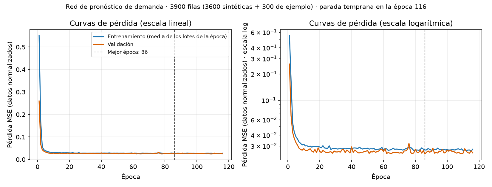

# 3. Arquitectura exacta de la red de pronóstico

*Generado con `docs/informe-datos/scripts/dataset_y_red.py` (las capas se leen del modelo real instanciado con `pronostico.entrenar.Red`).*

Red **feedforward** (perceptrón multicapa) que predice a la vez las 6 categorías (regresión multisalida). Entrenada con PyTorch; el servicio la evalúa solo con NumPy (`python-ia/pronostico.py`).

## 3.1 Capas

| # | Capa | Entrada → salida | Activación | Parámetros |
|---|---|---|---|---:|
| 1 | `Linear` (`net.0`) | 20 → 64 | ReLU | 1,344 (20×64 pesos + 64 sesgos) |
| 2 | `Linear` (`net.2`) | 64 → 32 | ReLU | 2,080 (64×32 pesos + 32 sesgos) |
| 3 | `Linear` (`net.4`) | 32 → 6 | ninguna (salida lineal) | 198 (32×6 pesos + 6 sesgos) |
| | **Total** | | | **3,622** (todos entrenables; `sum(p.numel())` = 3,622) |

## 3.2 Hiperparámetros de entrenamiento

| Concepto | Valor |
|---|---|
| Función de pérdida | **MSE** (`nn.MSELoss`) sobre las salidas **estandarizadas** |
| Optimizador | **Adam** (`torch.optim.Adam`), sin decaimiento de pesos |
| Tasa de aprendizaje | **0.005** (constante, sin *scheduler*) |
| Épocas | máximo **300**, con **parada temprana** (paciencia 30 épocas sin mejorar la validación en más de 1e-6) |
| Tamaño de lote | **64** (se barajan los índices en cada época) |
| Semilla | 42 (`torch.manual_seed` y `numpy.random.default_rng`) |
| Inicialización | la de PyTorch por defecto (Kaiming uniforme en `nn.Linear`) |
| Regularización | ninguna explícita (sin dropout ni L2); la parada temprana hace de regularizador y se conserva el estado de la mejor época |
| Dispositivo | CPU (`torch 2.15`) |
| Seguimiento | MLflow (SQLite local `python-ml/mlflow.db`); experimento `pronostico_demanda_categoria` |

## 3.3 Resultado del modelo vigente (`meta.json`)

Versión **202611231704-db2b1771**, entrenado el 2026-11-23T17:04:22+00:00, `datos = MIXTOS`.

| Conjunto | Modelo MAE | Modelo RMSE | Línea base MAE | Línea base RMSE |
|---|---:|---:|---:|---:|
| Validación | 7.82 | 15.72 | 59.63 | 93.29 |
| Prueba | 8.09 | 15.81 | 58.59 | 93.26 |

Error medio absoluto de validación por categoría (lo que muestra el panel como «confianza»): Copa 10.48, Vaso 6.34, Plato 9.02, Cubierto 18.28, Mantel 1.03, Otro 1.78.

## 3.4 Curvas de pérdida

* Se corrieron **116 épocas** antes de la parada temprana; la **mejor época fue la 86** (pérdida de validación 0.0243; entrenamiento en esa época 0.0269).
* Pérdida final: entrenamiento 0.0275, validación 0.0250.
* La pérdida de entrenamiento mostrada es la **media de las pérdidas de los lotes durante la época** (la red cambia mientras se mide); la de validación se mide al final de la época sobre todo el conjunto de validación.
* En esta reconstrucción: MAE de validación 7.82 y de prueba 8.09 (modelo vigente: 7.82 y 8.09).

### Cómo se obtuvieron (honestidad sobre el método)

`entrenar.py` solo registra en MLflow la pérdida de **validación** por época (`val_mse_norm`); la de entrenamiento no se guardaba. Por eso estas curvas salen de **volver a entrenar en memoria** con los mismos datos, división, semilla e hiperparámetros (sin tocar el modelo en producción ni MLflow). Para comprobar que es fiel al entrenamiento real se comparó la curva de validación reproducida con la guardada en MLflow para la ejecución `db2b1771f3314399a70b8d5e60f74e72`:

* **Coinciden**: 116 épocas comparadas, diferencia máxima absoluta 0.00e+00; mejor época en MLflow: 86.