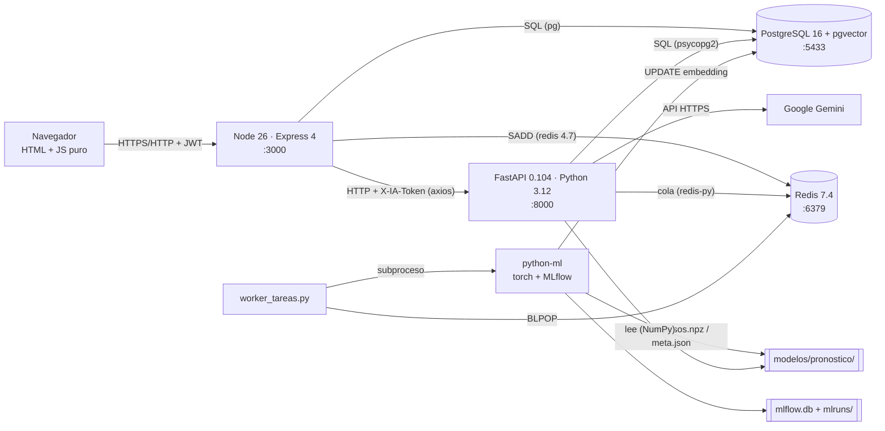

# 4. Tecnologías y versiones, por capa

Fuentes: `python-ia/requirements.txt`, `python-ml/requirements.txt`, `backend/package.json`, `docker-compose.yml` y, para
la columna **«Instalada»**, las versiones realmente presentes en el equipo el 23-11-2026 (`pip list`, `npm ls`,
`docker exec`). «Declarada» es lo que fijan los archivos del proyecto; cuando es un rango (`>=`), la versión instalada es la
que importa para reproducir resultados.

## 4.1 Presentación (navegador)

| Tecnología | Versión | Uso |
|---|---|---|
| HTML5 + CSS + **JavaScript puro (ES2020+)** | sin framework ni *bundler* | páginas en `backend/frontend/pages/*`, servidas como estáticos por Express |
| `fetch` + `apiFetch()` (`assets/js/app.js`) | API del navegador | llamadas a `/api/...` con JWT en la cabecera `Authorization` |
| Web Speech API (`SpeechRecognition`) | API del navegador | dictado por voz (Fase 6B); sin dependencias |
| SVG en línea (generado en `panel-ia-logica.js`) | — | gráfico de demanda real del Panel IA (sin librería de gráficos) |
| `sessionStorage` | API del navegador | historial del chat por usuario |

## 4.2 Lógica de negocio y API pública (Node.js)

| Paquete | Declarada (`package.json`) | Instalada | Uso |
|---|---|---|---|
| **Node.js** | — | v26.13.1 (npm 11.20.0) | entorno de ejecución |
| `express` | ^4.22.2 | 4.22.2 | servidor HTTP y rutas `/api` |
| `jsonwebtoken` | ^9.0.2 | 9.0.3 | autenticación JWT y roles (`cliente`, `trabajador`, `dueno`) |
| `bcryptjs` | ^3.0.3 | 3.0.3 | hash de contraseñas |
| `express-rate-limit` | ^8.7.0 | 8.7.0 | límites por usuario (chat, búsqueda, panel) |
| `cors` | ^2.8.5 | 2.8.6 | CORS restringido a `CORS_ORIGIN` |
| `axios` | ^1.20.0 | 1.20.0 | cliente HTTP hacia FastAPI (`services/iaService.js`) |
| `pg` | ^8.12.0 | 8.22.0 | acceso a PostgreSQL de la Opción 1 (alquileres, productos, usuarios) |
| `redis` | ^4.7.1 | 4.7.1 | cola de embeddings pendientes (`services/colaEmbeddings.js`) |
| `multer` | ^1.4.5-lts.1 | 1.4.5-lts.2 | subida de archivos (dependencia ya presente; sin uso nuevo en la Fase 6B) |
| `dotenv` | ^16.6.1 | 16.6.1 | variables de entorno |
| `nodemon` *(dev)* | ^3.1.4 | 3.1.14 | recarga en desarrollo |
| `node:test` *(pruebas)* | integrado en Node | — | 48 pruebas en `backend/tests` |

## 4.3 Microservicio de IA (Python)

| Paquete | Declarada (`requirements.txt`) | Instalada | Uso |
|---|---|---|---|
| **Python** | — | 3.12.10 | `python-ia/venv` y `python-ml/venv` |
| `fastapi` | ==0.104.1 | 0.104.1 | API del servicio de IA (`main.py`) |
| `uvicorn` | ==0.24.0 | 0.24.0 | servidor ASGI |
| `starlette` | (dependencia de FastAPI) | 0.27.0 | base de FastAPI / `TestClient` |
| `pydantic` | ==2.4.2 | 2.4.2 | validación de peticiones y respuestas |
| `google-generativeai` | ==0.8.5 | 0.8.5 | cliente de **Gemini** (modelo `GEMINI_MODEL`, hoy `gemini-3.6-flash`) |
| `psycopg2-binary` | ==2.9.9 | 2.9.9 | acceso a PostgreSQL con *pool* de conexiones |
| `sentence-transformers` | >=3.0,<6 | 5.7.0 | modelo de embeddings **`intfloat/multilingual-e5-small`** (384 dim) |
| `torch` / `transformers` | (dependencias de sentence-transformers) | 2.15.0 / 5.22.2 | inferencia de embeddings en CPU |
| `numpy` | (dependencia) | 2.5.4 | inferencia de la red de pronóstico sin torch (`pronostico.py`) |
| `redis` (cliente) | >=5,<7 | 6.4.0 | cola de tareas (`tareas.py`) |
| `python-dotenv` | ==1.0.0 | 1.0.0 | lectura de `.env` |
| `httpx` *(pruebas)* | ==0.27.2 | 0.27.2 | `TestClient` de Starlette |
| `fakeredis` *(pruebas)* | >=2.20 | 2.40.0 | Redis simulado en pruebas |
| `unittest` *(pruebas)* | biblioteca estándar | — | 108 + nuevas pruebas en `python-ia/test_*.py` |

## 4.4 Aprendizaje automático (entrenamiento)

| Paquete | Declarada (`python-ml/requirements.txt`) | Instalada | Uso |
|---|---|---|---|
| `torch` | >=2.2 (CPU) | 2.15.0 | entrenamiento de la red de pronóstico (`pronostico/entrenar.py`) |
| `mlflow` | >=3.0 | 3.18.0 | seguimiento de experimentos (SQLite local `mlflow.db`, artefactos en `mlruns/`) |
| `numpy` | >=1.26 | 2.5.4 | datos y división |
| `psycopg` (v3) | >=3.2,<4 | 3.3.8 | lectura de alquileres y carga de embeddings |
| `pgvector` (cliente) | >=0.3,<1 | 0.5.1 | tipo `vector` para psycopg |
| `sentence-transformers` | >=3.0,<6 | 5.7.0 | `cargar_embeddings.py` |
| `matplotlib`, `pandas`, `scikit-learn` | (instaladas, no declaradas) | 3.11.2 / 3.1.1 / 1.9.1 | gráficos de los scripts de medición |

## 4.5 Datos e infraestructura (`docker-compose.yml`)

| Componente | Imagen / versión | Puerto | Uso |
|---|---|---|---|
| **PostgreSQL** | `pgvector/pgvector:pg16` → PostgreSQL **16.15** | 5433 → 5432 | base relacional + vectorial + JSONB (`menaje_db`) |
| **pgvector** | extensión **0.8.7** | — | tipo `vector(384)`, operador `<=>`, índices HNSW |
| `pgcrypto` | 1.3 | — | `gen_random_uuid()` |
| **Redis** | `redis:7` → **7.4.12** | 6379 | cola de tareas, candados, embeddings pendientes |
| **Docker** | 29.9.3 (Compose v2) | — | levantar PostgreSQL y Redis (`docker compose up -d`) |
| Volúmenes | `pgdata`, `redisdata` | — | persistencia |

## 4.6 Servicios externos y modelos

| Servicio / modelo | Versión | Uso |
|---|---|---|
| **Google Gemini API** | modelo `gemini-3.6-flash` (variable `GEMINI_MODEL`; `gemini-1.5-flash` y `2.5-flash` ya no están disponibles para la clave) | respuesta del chat (`generate_content`); también «Recomendaciones» |
| `intfloat/multilingual-e5-small` (Hugging Face) | 384 dimensiones; prefijos `query: ` / `passage: ` | embeddings de productos, búsquedas y conversaciones |
| Red feedforward propia 20→64→32→6 | 3 622 parámetros (ver `03_arquitectura_red.md`) | pronóstico de demanda por categoría |

## 4.7 Cómo se comunican las capas

