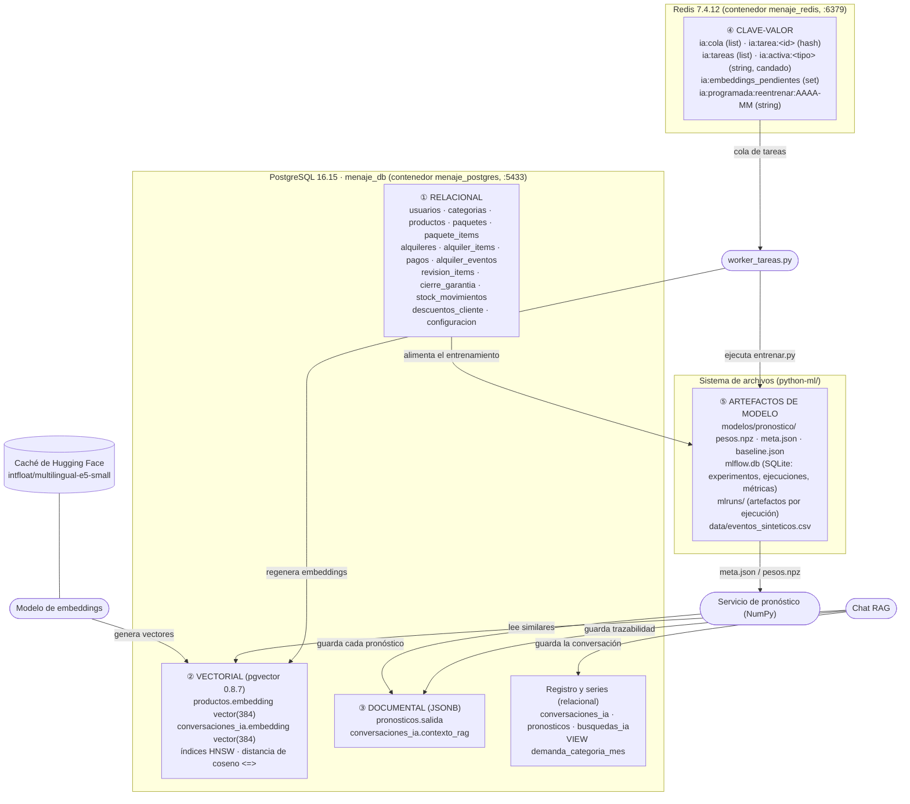

# 6. Mapa de los tipos de almacenamiento (base de datos multimodal)

El sistema no usa una única base: combina **cinco tipos de almacenamiento**, cada uno para lo que hace mejor. Los números son los del
equipo de desarrollo el 23-11-2026 (consultados en vivo, solo lectura).

## 6.1 Diagrama

## 6.2 ① Relacional — PostgreSQL

| Qué guarda | Tablas (filas) | Por qué relacional |
|---|---|---|
| Negocio de la Opción 1 | `usuarios` (12), `categorias` (6), `productos` (38), `paquetes` (10), `paquete_items` (58), `alquileres` (307: 300 de ejemplo + 7 reales), `alquiler_items` (3 650), `pagos` (2), `alquiler_eventos` (1), `revision_items` (1), `cierre_garantia` (1), `stock_movimientos` (2), `descuentos_cliente` (1), `configuracion` (1) | integridad referencial (claves foráneas), transacciones (stock, pagos, garantías), `CHECK` de dominio |
| Auditoría y medición de la IA | `conversaciones_ia` (consultas al chat, tokens, estado), `busquedas_ia` (cada búsqueda con su nº de resultados), `pronosticos` (historial) | consultas agregadas por día para el panel (`analitica.metricas_uso`) |
| Serie temporal | **vista** `demanda_categoria_mes` (132 filas): unidades por categoría y mes | se calcula al vuelo desde `alquileres` + `alquiler_items` + `productos` + `categorias`; no duplica datos |

Detalle completo de columnas, claves e índices en [`01_esquema_bd.md`](01_esquema_bd.md).

## 6.3 ② Vectorial — pgvector (dentro de PostgreSQL)

| Columna | Dimensión | Índice | Cobertura | Se consulta para |
|---|---:|---|---|---|
| `productos.embedding` | 384 | `idx_productos_embedding_hnsw` (HNSW, `vector_cosine_ops`) | 38 / 38 productos | búsqueda semántica, RAG de productos del chat, «Productos similares» |
| `conversaciones_ia.embedding` | 384 | `idx_conversaciones_embedding_hnsw` (HNSW, `vector_cosine_ops`) | 3 / 4 conversaciones | memoria del chat (conversaciones pasadas **del mismo usuario**) |

* Modelo: `intfloat/multilingual-e5-small` (multilingüe, vectores normalizados; `query: ` para consultas y `passage: ` para documentos).
* Medida: `similitud = 1 − (a <=> b)` (1 − distancia de coseno). Umbrales: búsqueda 0.85, chat/productos 0.82, memoria 0.85.
* Se mantiene junto a los datos relacionales a propósito: una sola consulta SQL filtra por `activo`, stock y categoría **y** ordena por cercanía.

## 6.4 ③ Documental — JSONB (dentro de PostgreSQL) y documentos JSON en disco

| Dónde | Documento | Para qué |
|---|---|---|
| `pronosticos.salida` (JSONB) | `{"Copa": 459, "Vaso": 120, …}` | historial de lo que se pronosticó, con la entrada (`tipo_evento`, `mes`, `asistentes`), el `modo` y la `version_modelo` |
| `conversaciones_ia.contexto_rag` (JSONB, migración 008) | `{"productos": [{"id","nombre","similitud"}], "memoria": [{"id","similitud","mensaje_usuario"}], "umbral_productos", "umbral_memoria"}` | trazabilidad: qué recuperó el RAG para cada respuesta. Esquema flexible: puede crecer sin migrar; `NULL` si el RAG no corrió |
| `python-ml/modelos/pronostico/meta.json` | versión, fechas, composición de datos, categorías, escala, `y_media`/`y_desv`, error de validación por categoría, métricas | contrato entre el entrenamiento y el servicio de inferencia; el panel lee de aquí «Datos del último entrenamiento» |
| `python-ml/modelos/pronostico/baseline.json` | promedio histórico por categoría y mes + su error | respaldo del **modo degradado** |

## 6.5 ④ Clave-valor — Redis

Estado en vivo al consultarlo (todas las claves llevan el prefijo `ia:`; Redis **no guarda datos de negocio**, solo coordinación):

| Clave | Tipo Redis | Contenido | Caducidad |
|---|---|---|---|
| `ia:cola` | list | ids de tareas pendientes (`RPUSH` al encolar, `BLPOP` en el worker) | — |
| `ia:tarea:<id>` | hash | `id, tipo, estado, creada, inicio, fin, detalle` | 7 días (observado: ≈ 6,8 días restantes) |
| `ia:tareas` | list | los 50 ids de tareas más recientes (`LTRIM 0 49`) | — |
| `ia:activa:<tipo>` | string | candado `SET NX`: una sola tarea pendiente o en curso por tipo | `TAREA_TIMEOUT_S + 300` s (2 100 s) |
| `ia:embeddings_pendientes` | set | ids de productos creados o editados cuyo embedding hay que regenerar (`SADD`/`SPOP`) | — |
| `ia:programada:reentrenar:AAAA-MM` | string | marca de «ya se encoló el reentrenamiento de este mes» (`SET NX`) | 45 días |

Observado ahora: `ia:tareas` (1 lista), 2 hashes `ia:tarea:*` y `ia:programada:reentrenar:2026-11`.

## 6.6 ⑤ Artefactos de MLflow y del modelo (sistema de archivos)

| Ubicación | Contenido | Tamaño aprox. |
|---|---|---|
| `python-ml/mlflow.db` | SQLite de MLflow 3.18: 2 experimentos (`Default`, `pronostico_demanda_categoria`), **10 ejecuciones**, 976 métricas, 106 parámetros (semilla, lr, épocas, tamaños de conjunto, composición de datos) | 1,4 MB |
| `python-ml/mlruns/1/<run_id>/artifacts/paquete_servicio/` | copia de `pesos.npz`, `meta.json` y `baseline.json` de **cada** entrenamiento (permite volver a una versión anterior) | — |
| `python-ml/mlruns/1/models/m-…/artifacts/` | el modelo PyTorch registrado con `mlflow.pytorch.log_model` (`MLmodel`, `conda.yaml`, `python_env.yaml`, `input_example.json`, pesos) | 683 KB en total `mlruns/` (90 archivos) |
| `python-ml/modelos/pronostico/` | el **paquete en servicio** (el que lee FastAPI): `pesos.npz` (16 KB), `meta.json` (3,4 KB), `baseline.json` (3 KB) | 24 KB |
| `python-ml/data/eventos_sinteticos.csv` | dataset sintético (3 600 filas, semilla 42) | — |

`mlflow.db` y `mlruns/` están en `.gitignore` (no se versionan); `modelos/pronostico/` sí. MLflow se usa **sin servidor** (URI `sqlite:///…`).

## 6.7 Resumen: qué dato va dónde y por qué

| Necesidad | Almacenamiento | Motivo |
|---|---|---|
| Alquileres, stock, pagos, usuarios | Relacional | integridad y transacciones |
| «Encuentra algo parecido a lo que describo» | Vectorial (pgvector) | búsqueda por significado, no por palabras |
| Lo que recuperó la IA en cada respuesta; salida de cada pronóstico | Documental (JSONB) | estructura variable, sin migrar columnas |
| Cola de tareas, candados, pendientes | Clave-valor (Redis) | operaciones atómicas y rápidas, datos efímeros |
| Pesos de la red, versiones, métricas de entrenamiento | Artefactos (MLflow + archivos) | trazabilidad y reproducibilidad de los modelos |
